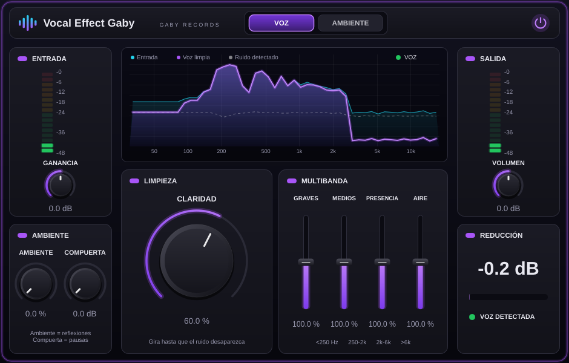

# Vocal Effect Gaby

Plugin **VST3 para Mac** de **Gaby Records** que limpia la voz: quita ruido de fondo, zumbidos y ambiente en tiempo real. Está hecho para usarse en ACE Studio y en cualquier programa que acepte plugins VST3.

## Controles

| Control | Qué hace |
|---|---|
| **Claridad** | Cantidad principal de limpieza. Gira hasta que el ruido desaparezca. |
| **Ambiente** | Devuelve parte de las reflexiones del cuarto para un sonido natural. |
| **Compuerta** | Baja aún más el ruido entre frases (cuando no hay voz). |
| **Multibanda** | Limpieza independiente en Graves (<250 Hz), Medios (250 Hz–2 kHz), Presencia (2–6 kHz) y Aire (>6 kHz). |
| **Voz / Ambiente** | Voz = deja la voz limpia. Ambiente = quita la voz y deja solo el fondo. |
| **Ganancia / Volumen** | Nivel de entrada y de salida. |
| **Encendido** | Prende o apaga el efecto (sin cambiar la latencia). |

## Cómo obtener el plugin

1. Pestaña **Actions** → última ejecución con ✅.
2. En **Artifacts** descarga **Vocal-Effect-Gaby-Mac**.
3. Sigue `INSTALAR.txt`.

## Cómo funciona

Reducción de ruido espectral (STFT con 75 % de traslape), estimación automática del ruido por frecuencia, filtro de Wiener con SNR a priori *decision-directed*, suavizado anti "ruido musical", detector de voz para la compuerta y 4 bandas de control. Hecho con [JUCE](https://juce.com) 8.
